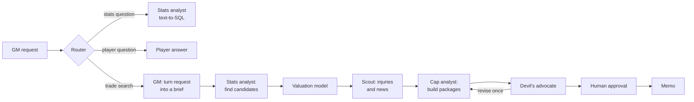
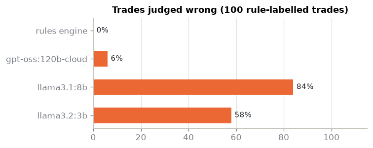
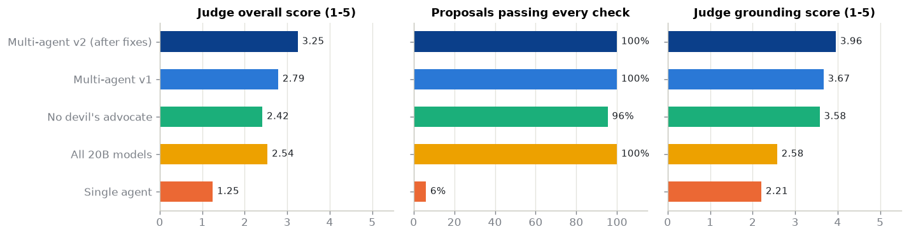

# Front Office

An AI analyst team for an NBA front office. You describe what your team needs in plain language, for example *"we need a rim-protecting center who can play now, stay below the second apron and keep our 2029 first"*, and a group of agents searches the data, values the candidates, builds trade packages that are legal under the league's salary rules, argues against them, and writes a memo. Nothing is final until you, as the general manager, approve it.

The project is built around one question: which parts of this job should a language model do, and which parts should be plain code? Every design decision below was settled by measuring it.

## How it works



The agents are a [LangGraph](https://langchain-ai.github.io/langgraph/) state graph. They never touch the database directly; every fact comes through a separate MCP server (see below), the same one you can plug into Claude Desktop or any other MCP client.

| Step | What it does | LLM or code |
|---|---|---|
| Router | Decides whether the request is a trade search, a factual question or a question about one player | LLM (small model) |
| GM | Turns the request into a structured brief: positions, minimum projected Win Shares, age, salary ceiling, payroll line to stay under, protected picks, untouchable players | LLM |
| Stats analyst | Writes DuckDB SQL to find candidates or answer a question; if the query fails or returns nothing, it reads the error and rewrites it (up to three tries) | LLM + SQL |
| Valuation | Projects next season's Win Shares with an 80% interval and puts a dollar value on the contract | LightGBM model |
| Scout | Reads injury reports and ESPN headlines, treating them as untrusted text | LLM (small model) |
| Cap analyst | Finds salary-matching packages, adds picks until the other team is not losing value, and asks the rules engine whether the trade is legal | Code |
| Devil's advocate | Argues against every proposal; a proposal it drops, or one it thinks the other team would refuse, goes back to the cap analyst for one more round | LLM |
| Approval | The graph pauses (LangGraph `interrupt`) until the GM approves or rejects each proposal; runs are checkpointed in SQLite, so they survive a restart | Human |
| Memo | Writes the recommendation from a fact sheet, so it can only cite numbers that the tools produced | LLM |

## Why the salary rules are code, not a prompt

Whether a trade is legal depends on the team's payroll position, salary-matching brackets, the two aprons, roster limits, the Stepien rule on future first-round picks, recently signed players and cash limits. I implemented these rules from the 2023 CBA with the official 2026-27 figures (cap $164.96M, tax $200.43M, aprons $209.02M and $221.69M) as a small Python engine with unit and property-based tests.

To check whether that was necessary, I built 100 test trades (42 legal, 58 illegal across ten kinds of violation) and gave the same cap sheets to language models:

| Judge | Fully correct | Legal / illegal verdict right | Approves illegal trades | Time per trade |
|---|---|---|---|---|
| Rules engine | 100% | 100% | 0% | < 1 ms |
| gpt-oss 120B | 94% | 99% | 1.7% | 9.8 s |
| Llama 3.2 3B | 42% | 42% | 100% | 3.9 s |
| Llama 3.1 8B | 16% | 57% | 21% | 6.3 s |

The largest model is good, but it still approved an illegal trade and got the reason wrong in 6 of 100 cases, and it is ten thousand times slower. Small models are unusable. So the engine decides legality and the LLMs only reason about what the engine reports.



## Data

Everything lives in one DuckDB file of about 9.7 million rows, built by an idempotent ETL from free sources:

- nba_api (NBA.com): players, rosters, box scores and game logs, 2010-11 to 2025-26 (404k player games).
- Play-by-play: 9.3 million events from the public `nba_data` archive, with gaps filled from NBA.com.
- Basketball-Reference: advanced stats, current contracts by season and the transaction log.
- Draft picks: there is no free API for pick ownership, so `data/draft_picks.py` replays every pick trade in the transaction log since 2019-20 to work out who owns which pick. Cases it cannot resolve are written to a review file instead of being guessed.
- ESPN: injury report and news headlines.

Real data is messy: names differ between sources (`Nikola Jokić` vs `Nikola Jokic`), traded players appear on several teams in one season, and play-by-play event numbers are not in time order. Sixteen quality checks run after each build. A 13 MB sample warehouse is committed so the tests and the app work from a fresh clone.

## Player valuation model

The model predicts a player's Win Shares next season, scaled to 82 games, from his last three seasons, age, minutes and availability. Win Shares was chosen because it is public and its history goes back far enough to train on; paid metrics such as EPM are not available.

Hyper-parameters were tuned with expanding-window cross-validation on seasons up to 2020-21 and checked on the next two seasons. Predictions for 2024-25 and 2025-26 were held out as the test set:

| Model | MAE | Spearman |
|---|---|---|
| Last season repeated | 1.63 | 0.62 |
| Marcel (weighted average + aging) | 1.49 | 0.65 |
| Ridge regression | 1.47 | 0.65 |
| **LightGBM** | **1.43** | **0.67** |

The improvement over the classic Marcel baseline is real but modest, which is typical for this problem. Each projection comes with an 80% interval from quantile regression widened by conformal calibration (77% actual coverage on the test seasons, 80% on validation), and SHAP values explain the main factors behind each number. The projection is converted to dollars with the league's going rate per Win Share, which gives each contract a surplus value. The notebook in `models/notebooks/valuation.ipynb` walks through the target, the aging curve, the results and the intervals.

## MCP server

`mcp_server/` is a standalone [Model Context Protocol](https://modelcontextprotocol.io) server with nine read-only tools: SQL over the warehouse, schema description, team cap sheets, trade validation, salary-matching search, player valuation, draft assets and player news. The database is opened read-only with external file access disabled, and `run_sql` accepts a single `SELECT` with a row limit and a timeout. It runs over stdio or HTTP and works with Claude Desktop; [its README](mcp_server/README.md) has the setup.

## Evaluation

The benchmark (`evals/nba_bench/`) has three layers plus a security test:

1. 84 questions with exact answers generated from the warehouse with SQL: league leaders, a player's salary in a given season, who owns a draft pick, injury status, clutch scoring from play-by-play. Answers are checked automatically with tolerances for numbers and aliases for names.
2. 100 labelled trades for the rules comparison above. This also runs in CI on every pull request, so a change to the rules engine that flips a verdict fails the check.
3. 24 open-ended trade requests, each with constraints that code can check: legality, positions, age, protected picks, untouchable players and the payroll line. A second model from a different family (Gemma) scores each reply from 1 to 5 on goal fit, realism, grounding, risk awareness and overall usefulness.
4. 25 prompt-injection cases: fake news articles that try to change a player's injury status, give orders, push a specific trade or leak a secret.

### Ablations

I ran the same benchmark with parts of the system removed or replaced:

| System | Exact answers | Judge overall (1-5) | Proposals passing every check | Tokens per trade request | Cost per trade request* |
|---|---|---|---|---|---|
| **Multi-agent, final** | **99%** | **3.25** | **100%** | 17.8k | $0.0052 |
| Multi-agent, first version | 86% | 2.79 | 100% | 16.3k | $0.0047 |
| Without the devil's advocate | – | 2.42 | 96% | 10.9k | $0.0025 |
| All roles on the 20B model | 84% | 2.54 | 100% | 17.9k | $0.0022 |
| Without SQL self-correction | 86% | – | – | – | – |
| One agent with all tools | 99% | 1.25 | 6% | 110.2k | $0.0203 |

<sub>*At public list prices for the same open models (`config/models.yaml`). The runs themselves used Ollama's free cloud tier. The ablation rows were run on the first version; "final" is the same system after the fixes described below.</sub>

What this shows:

- For simple factual questions, one agent with tools is enough. It answered 99% correctly. The first multi-agent version only reached 86% because the router sent questions such as "how much is X paid in 2027-28?" to the wrong place.
- For constrained, multi-step decisions, the structure matters. The single agent proposed trades that passed every check only 6% of the time (it invented rosters and ignored constraints) and used six times more tokens. The multi-agent system never proposed an illegal trade.
- The devil's advocate earns its cost. Without it the judge's risk-awareness score halves (4.08 to 2.04) and some proposals start failing constraints.
- Smaller models hurt grounding more than anything else (3.67 to 2.58) and produce far fewer proposals.



### Can the judge be trusted?

An LLM judge needs checking. I validated it against the deterministic checks instead of trusting it blindly: across all 96 scenario replies it gave every empty or crashed reply a 1, and it ranked a reply whose proposals all passed the checks above one with a failing proposal 84% of the time (AUC 0.84). It is weaker at separating goal fit (0.72) and grounding (0.66), and it does not always penalise a trade that makes the team worse. A planned comparison with human labels was not completed, so treat the judge scores as a rough signal and the deterministic checks as the main evidence.

### Fixing what the benchmark found

Reading the failures led to five fixes: factual questions about one player now go to the SQL analyst with their own prompt; the brief can carry a salary ceiling (a request for a "backup big" used to return Jokić and Wembanyama); the other team now asks for first-round picks in proportion to the talent it gives up, more for players 25 or younger; "no first-round picks" became an explicit field; and the memo's fact sheet now spells out the payroll line and what a hard cap means, because the model kept reading "hard capped at the second apron" as "over the second apron". A separate check confirmed that all 108 benchmark requests are routed correctly after the change.

Exact answers went from 85.7% to 98.8% (12 questions fixed, 1 broken, McNemar p = 0.003). The judge's overall score on the scenarios rose by 0.46 on average, but with 24 scenarios and one run each, the 95% confidence interval is −0.29 to +1.21, so that gain cannot be separated from run-to-run noise. The full numbers are in [`evals/results/REPORT.md`](evals/results/REPORT.md).

### Prompt injection

The scout reads text from the internet, so it is the obvious attack surface. Without defences, all 20 injected articles changed the scout's report. With the defences (external text wrapped in `<untrusted>` tags, a prompt that tells the scout to treat it as data, and a field for flagging suspicious content), none of them succeeded, every attack was flagged, and none of the five normal articles was flagged. The scout also has no tools, so even a successful injection could only distort its report, not act.

## Observability and cost

Every run is traced in a self-hosted [Langfuse](https://langfuse.com) (`infra/langfuse/`): one trace per request, a span per agent, a generation per LLM call with tokens and cost, and a span per MCP tool call. Judge scores are attached to the traces of benchmark runs. A trade request takes about a minute and roughly 18k tokens, about half a cent at list prices; a factual question takes about 11 seconds.

## Running it

You need Python 3.11+ and [uv](https://docs.astral.sh/uv/). The models run through [Ollama](https://ollama.com): either sign in to the Ollama app (`ollama signin`) to use its cloud models, or put an `OLLAMA_API_KEY` in `.env`. Without the full warehouse everything falls back to the bundled sample.

```bash
uv sync
cp .env.example .env

# the web app
uv run streamlit run app/streamlit_app.py

# or the command line
uv run python -m agents.cli "We need a backup center who rebounds well" --team DEN

# check a trade with the rules engine alone
uv run python -m rules.cli "DEN>GSW:Nikola Jokić" "GSW>DEN:Stephen Curry"
```

With Docker, `docker compose up` starts the app on `localhost:8501` and the MCP server on `localhost:8765/mcp`. Langfuse is optional and has its own compose file in `infra/langfuse/`.

To build the full warehouse and retrain the model (this can take hours, since the scrapers respect the sites' rate limits):

```bash
uv run python -m data.build_warehouse
uv run python -m models.valuation.train
uv run python -m models.valuation.predict
```

Tests and lint: `uv sync --group dev`, then `uv run pytest` and `uv run ruff check .`. The benchmark runners are in `evals/runners/`, `python -m evals.run_ablations` runs the whole matrix, and `python -m evals.report` rebuilds the tables and figures.

## Project layout

```
agents/       LangGraph graph, agents, prompts, LLM providers, tracing
app/          Streamlit app
config/       salary cap figures for 2026-27, model per role, trade market settings
data/         ETL, schema, data quality checks, draft pick ledger, sample warehouse
evals/        NBA-Bench, runners, judge, ablations, report
infra/        self-hosted Langfuse
mcp_server/   standalone MCP server
models/       valuation model, notebook, trained artifact
rules/        CBA rules engine and its tests
```

## Limitations

- Trade realism is the weakest part. The judge rates realism 2.8 out of 5. Contract value is linear in Win Shares, while real teams pay a premium for stars and young players. The pick-for-talent rule moves things in the right direction, but its prices are rough: it sometimes asks too little for an All-Star and too much from a rebuilding team.
- The memo still occasionally misstates a fact that is not in its fact sheet, such as a player's age or role.
- The rules engine covers the core of the CBA, not all of it: no sign-and-trades, traded player exceptions are calculated but never used to absorb salary, and trade kickers and partial guarantees are not modelled.
- Results come from one run per configuration. The scenario layer is too small to detect differences below about one point on the judge scale.
- Contract and injury data are a snapshot from October 2026.
